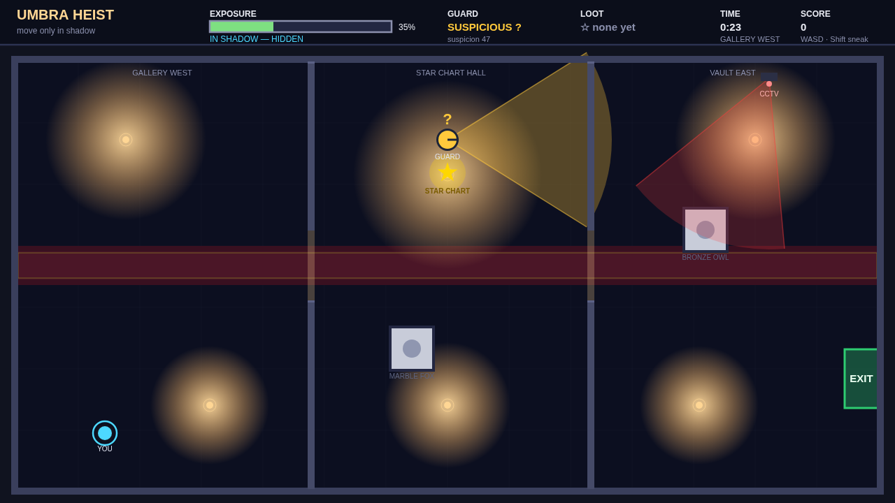

# UMBRA HEIST — move only in shadow

A top-down stealth game for make.fun's **best-stealth-game-20261121-1759**
($50, judge: image). You are a thief in a museum at night. Light is the enemy:
move fast only in shadow, steal the Star Chart, and reach the green EXIT unseen.



## The one mechanic: shadow is a resource

- **Fast in shadow, slow in light.** You run at 175 px/s in the dark blue shadow
  and only 95 px/s under the warm lamps.
- **Exposure meter (HUD).** Standing or moving in light fills it (+28/s moving,
  +15/s standing). In shadow it drains (−20/s). At **100% the guard is called**
  to your position.
- **Shift = sneak.** 68 px/s, silent — and it fills **no** exposure even in light.
  Slow, but safe at the edge of a lamp.

## The guard: 3 stages of suspicion

- **CALM** — patrols 4 waypoints around the Star Chart Hall.
- **SUSPICIOUS (?)** — stops, turns toward what he saw, stares. Lose him and he
  calms down; stay visible and he escalates.
- **CHASING (!)** — runs at you at 205 px/s. Break line of sight for 3 seconds
  and he drops back to suspicious. Get within ~24 px and you are **caught**.
- His **vision cone** (yellow, turning orange then red as he escalates) is drawn
  on the floor — and the two marble statues **block his line of sight**. Hide
  behind one.

## The level: a 3-room museum

- **Gallery West** (entry) → **Star Chart Hall** (the loot) → **Vault East**
  (the exit), joined by two doorways.
- **1 guard + 1 CCTV camera** — the camera's red cone sweeps Vault East and
  fills your exposure (+48/s) when it sees you.
- **2 statue covers** (Marble Fox, Bronze Owl) that block vision cones.
- **1 loot: the Star Chart**, hanging under the brightest lamp in the middle
  room — +500 points, but the light around it is the most dangerous spot in
  the museum. **1 exit:** the green EXIT door in Vault East.
- **Win:** reach the exit. With the Star Chart: *"UNSEEN — escaped with the
  Star Chart"* (+time bonus). Without it you escape, but the chart stays.

## HUD

Exposure meter + in-light/in-shadow readout, guard stage and suspicion %,
loot, timer, current room, score.

## Controls

- **WASD / arrows** — move
- **Shift** — sneak (slow, silent, no exposure in light)
- **Space / Enter** — start · **P / Esc** — pause · **R** — restart after a win or a capture

## Sound

Synthesised in code with WebAudio (no audio files): soft footsteps, a loot
chime, a two-tone alarm while the guard chases, a win fanfare, a capture sting.

## Screenshots (real renders of this code)

1. `01-wide.png` — the whole museum in one frame: level, guard cone, light/shadow contrast, statue cover, loot, exit, exposure meter
2. `02-shadow.png` — the shadow mechanic: player at the edge of the bright lamp, exposure at 62%
3. `03-spotted.png` — the near-miss: guard at CHASE ("!"), cone on the player, exposure 88%
4. `04-hud.png` — the goal: Star Chart taken, player at the EXIT, exposure low

## Run it

```sh
node serve.ts        # then open http://localhost:8080
```

Or open `game/index.html` directly in desktop Chrome. No network requests,
no libraries — vanilla JS + canvas 2D. `?shot=wide|shadow|spotted|hud`
stages each screenshot scene deterministically.

## Numbers (the evidence)

3 rooms · 1 guard · 1 CCTV camera · 2 statue covers · 3 suspicion stages ·
1 loot (Star Chart) · 1 exit · exposure 0–100 · guard vision 235 px / ±32° ·
patrol 88 px/s · chase 205 px/s · shadow 175 px/s · light 95 px/s · sneak 68 px/s

## License

MIT — see [LICENSE](LICENSE).
